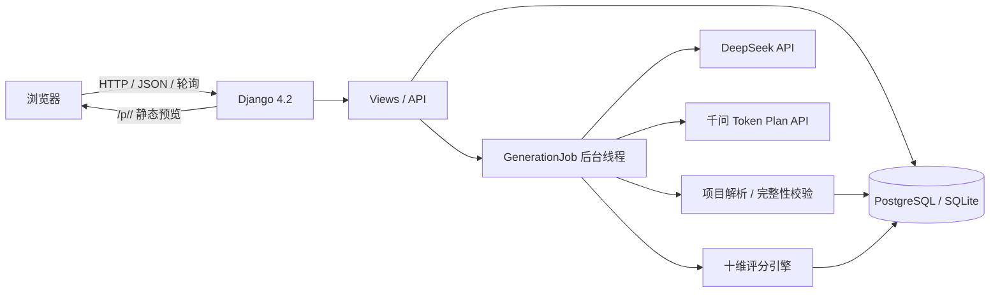

# PromptForge 说明文档

> 面试笔试 Demo · Django 4.2 全栈 AI 应用生成工作台  
> 文档版本：1.0 · 日期：2026-11-27

## 1. 项目定位

PromptForge 是一个“用自然语言生成可运行 Web 应用”的演示平台：用户输入需求或选择模板，平台调用 DeepSeek / 千问生成完整前后端项目，提供预览、源码、版本迭代、在线修改、下载和临时发布。

这个项目选择 **Django 4.2** 作为主框架，原因是：

- 需求本身要求生成 Django 全栈项目，宿主平台使用同技术栈，生成器和被生成项目的心智模型一致。
- Django 自带 ORM、迁移、Admin、认证、模板、CSRF、安全中间件，适合在笔试有限时间内交付完整闭环。
- `GenerationJob`、版本快照、发布记录都适合用关系模型表达，便于展示数据建模能力。
- 可以输出 `DEPLOY.md`、ZIP、生产部署文档，体现“不是只做页面 Demo”。

需要明确：这个项目是**面试笔试 Demo**，不是已经完成商业化的多租户 PaaS。演示版与生产版的能力边界见第 9、10 节。

## 2. 核心用户流程

```text
主页
  ├─ 输入需求 / 点击模板
  ├─ 弹出模式选择框
  │    ├─ 推荐单模型（按历史胜率）
  │    ├─ 另一个单模型
  │    └─ 双模型赛马
  └─ 进入生成工作台
       ├─ 左侧：阶段 / 进度 / 模型处理状态 / 任务
       ├─ 右侧：预览 / 源码目录树
       ├─ 在线修改：点选或框选组件 → 选择范围 → 后台修改
       ├─ 版本历史：切换 / 下载 ZIP / 删除
       └─ 发布：当前域名下生成临时静态预览路由
```

主页与工作台都通过轮询 `/api/jobs/` 获取状态；后台线程继续执行，不依赖浏览器连接。

## 3. 系统架构

### 3.1 总体架构



### 3.2 代码分层

```text
.
├── manage.py
├── requirements.txt
├── .env.example
├── README.md
├── DEPLOY_ALIYUN_ECS.md
├── docs/
│   ├── 说明文档.md
│   ├── 测试文档.md
│   └── 验收清单.md
├── webgen/
│   ├── settings.py          # 环境变量、数据库、安全、静态文件
│   ├── urls.py
│   ├── wsgi.py
│   └── asgi.py
└── generator/
    ├── models.py            # 生成记录、版本、发布、后台任务
    ├── views.py             # API、生成流程、解析、发布、下载
    ├── scoring.py           # 十维确定性评分引擎
    ├── urls.py
    ├── tests.py             # 评分/解析/任务/统计回归测试
    └── templates/
        └── index.html       # 主页 + 工作台单页应用
```

### 3.3 技术选型

| 层 | 选型 | 说明 |
| --- | --- | --- |
| Web 框架 | Django 4.2.30 | 宿主平台和生成项目默认栈 |
| 数据库 | PostgreSQL（生产）/ SQLite（本地） | `dj-database-url` 统一解析 `DATABASE_URL` |
| 异步任务 | `threading.Thread` + `GenerationJob` | Demo 轻量方案，生产建议 Celery/RQ |
| 大模型 | DeepSeek + 千问 Token Plan | OpenAI 兼容接口 |
| 前端 | Django 模板 + 原生 JS/CSS | 无构建步骤，便于笔试交付 |
| 预览隔离 | iframe `srcdoc` + sandbox | 生成页面与宿主隔离 |
| 发布隔离 | CSP `sandbox` | 仅有脚本能力，无同源存储 |
| 容器化 | 未包含 | 正式发布方案见第 9 节 |

## 4. 功能详解

### 4.1 主页

- 多层次紫/青/粉/琥珀渐变背景与细点阵装饰，卡片保持白色对比。
- 需求输入框，支持 Ctrl / ⌘ + Enter 提交。
- 参考图上传：JPG/PNG/WebP/GIF，浏览器端压缩并提取尺寸/主色/亮度；生成时用于视觉分析。
- 五个模板：2048、扫雷、番茄钟、待办清单、个人作品集。
- 项目列表：项目级信息默认折叠，点击箭头展开版本。
- 项目多时列表独立滚动，卡片不压缩；展开后自动滚动到该项目。
- 已发布项目的卡片使用绿色背景。
- 右键项目卡片：删除整个项目及全部版本；若含已发布版本，确认框会提示发布链接将失效。
- 任务面板显示进行中 / 失败的生成任务和修改任务，支持删除运行中任务。

### 4.2 生成模式选择与推荐

用户点击「开始生成」或模板后，不会立即启动生成，而是弹出选择框：

- 展示历史赛马任务的双方胜场、胜率、平均分和逐条记录。
- 历史统计读取**所有已完成的赛马任务**，包含后来被删除的项目。
- 推荐胜出率更高的单模型；用户可以改选另一个模型，也可以选择双模型赛马。
- 单模型选择会通过 `/api/jobs/start/` 的 `provider` 参数传给后台。
- 关闭弹窗则取消本次提交，不启动任务。

### 4.3 全栈项目生成

后台任务流程：

```text
解析需求
  → 判断全栈 / 显式前端-only
  → 上传参考图时：提取尺寸/主色/亮度 → 视觉模型分析
  → 构造全栈或前端-only 提示词（注入参考图分析）
  → 并发调用一个或两个模型
  → 容错解析 ===FILE: ... === / ===END_FILE===
  → 检查项目完整性（全栈或前端目录）
  → 十维评分（赛马）
  → 写入历史 / 版本 / 项目文件
  → 标记任务完成
```

关键设计：

- **容错解析**：兼容缺少 `===END_FILE===`、缺少 `===FILES===` 的模型输出，按下一个文件/预览标记拆分，避免所有代码被塞进 `requirements.txt`。
- **完整性校验**：至少 6 个文件，并同时具备依赖清单、后端入口/目录、前端模板/静态资源、`DEPLOY.md`；单模型不完整时使用完整 Mock Django 项目兜底；赛马优先在完整方案中选优。
- **Mock 兜底**：API Key 缺失、请求失败、输出不可解析时仍能保存可运行项目，保证演示不中断。
- **超时隔离**：DeepSeek 后台生成 90 秒；千问独立 `QWEN_BACKEND_TIMEOUT=180` 秒；千问超时不再被误报为“项目结构不完整”。
- **空文件保留**：`__init__.py` 等空文件会保留，下载 ZIP 时目录结构完整。
- **显式前端-only**：需求中包含“纯前端 / 只生成前端 / 不要后端 / 前端代码即可”等明确指令时，使用前端专用系统提示词和完整性校验，只生成 HTML、`src/`、`styles/`、`assets/`、依赖、README 和 DEPLOY；不会生成 Django/数据库。
- **前端 Mock 兜底**：前端-only 输出不完整时使用完整前端目录兜底，而不是后端 Mock 计算器。
- **参考图**：浏览器压缩图片并提取元信息；后台优先调用 `QWEN_VISION_MODEL`（默认 `qwen3.8-flash`）分析布局、配色、组件和字体，将描述注入双方共用提示词；视觉模型不可用时退回尺寸/主色/亮度。
- **参考图不泄露**：图片只存入任务记录，不出现在任务列表 API；有大小/MIME/base64 校验。

### 4.4 双模型赛马与十维评分

赛马模式下，两个模型并发生成完整项目；评分器不接收模型名称，双方使用同一提示词和同一套确定性规则。

| 维度 | 分值 | 主要检查 |
| --- | ---: | --- |
| 页面结构与完整性 | 10 | DOCTYPE、HEAD/BODY、标题、viewport、CSS、语义标签、闭合 |
| 需求覆盖 | 15 | 从提示词识别 2048/计算器/待办/扫雷/作品集/番茄钟等功能，检查棋盘、方向键、最高分、筛选、计时器等 |
| 交互能力 | 15 | 脚本、控件、事件绑定、事件类型多样性、DOM 反馈、业务逻辑 |
| 状态管理与持久化 | 10 | localStorage、状态更新、重置、历史记录、校验/错误处理 |
| 视觉设计 | 10 | CSS 规则、Flex/Grid、阴影/圆角/渐变/动效、变量/字体、颜色、间距 |
| 响应式适配 | 10 | viewport、媒体查询、相对单位、流式尺寸、触摸、溢出处理 |
| 可访问性 | 10 | lang、语义标签、alt、label、ARIA、焦点、按钮名称、可读正文 |
| 内容质量 | 8 | 正文丰富度、标题层级、区块多样性、无占位符、引导文案、文本密度 |
| 代码与安全 | 7 | 危险 API、重复 ID、HTTP 资源、TODO、体积、结构化 JS、标签闭合 |
| 性能与资源 | 5 | 外部资源数量、DOM 规模、内联资源体积、超大 Base64 |

评分详情中每个维度可展开查看具体检查项、得分和失分项；同分时综合比较需求覆盖、交互能力、状态管理和内容质量。

### 4.5 后台任务与并发

- 每个任务使用 UUID、独立线程和 `GenerationJob` 记录。
- 浏览器使用 `client_id`（localStorage 生成）隔离任务面板；这不是登录身份认证，只是浏览器标识。
- 主页/工作台轮询任务状态，离开页面不会中止线程。
- 任务可取消：删除运行中任务会设置取消事件、异步关闭模型 HTTP 响应、停止工作线程，并清理部分数据；`_save_job` 使用 `QuerySet.update()` 检查受影响行数，已删除的任务不会被旧线程“复活”。
- 本地 SQLite 设置了 20 秒忙等待；生产环境使用 PostgreSQL。

### 4.6 工作台：预览、源码、版本

- **预览**：`iframe srcdoc` + `sandbox="allow-scripts"`。
- **存储兜底**：沙箱 opaque origin 下原生 localStorage 会抛 `SecurityError`，平台注入内存存储垫片；已发布页面进一步把存储镜像到 `__pf_store` URL 参数，刷新后可恢复。
- **源码视图**：左侧目录树、右侧在线编辑器；目录可折叠，文件可直接修改。
- **实时预览**：编辑 `preview.html` 直接刷新预览；前端-only 项目会从 `index.html` 内联本地 CSS/JS 重建 srcdoc；全栈项目建议编辑 preview.html 查看视觉变化。修改内容先留在草稿中，不立即写数据库。
- **离开/切预览保护**：从源码切到预览、切换版本、返回主页、打开在线修改或提交修改时，如有源码草稿，弹出“是/否”对话框；是=调用 `/source/` 更新当前版本（不新增版本）并按保存结果渲染预览，否=丢弃草稿并恢复原预览；关闭对话框则继续编辑。刷新/关闭浏览器由 beforeunload 提示。
- **版本切换**：下拉框、左侧版本列表、对话中的版本链接都可以切换。
- **版本树**：左栏按 `base_version` 父子关系缩进展示，修改版本标注“基于 vN”，可以形成多条分支。
- **URL 可恢复**：`/workspace/?history=<id>&version=<id>`。

### 4.7 在线修改

- 点击「在线修改」打开左侧 AI 对话面板，不遮挡右侧预览。
- 支持点击单个组件，也支持拖拽框选多个组件。
- 选区出现后，两个范围按钮高亮闪烁，必须先选择「是，只修改框选组件」或「否，按语言指令修改」，防止用户不知道输入框为什么不可用。
- 修改提交后进入后台 `refine` 任务；可以立即返回主页，在「生成任务」面板继续查看。
- 修改任务显示为「修改「项目名」vN」；完成后自动生成新版本并刷新项目列表。
- 删除运行中的修改任务不会删除项目已有版本。

### 4.8 版本、下载、删除

- 每个版本是不可变快照；在线修改会追加新版本。
- 下载 ZIP 包含全部前后端源码、依赖清单、`DEPLOY.md` 和 `preview.html`。
- 删除版本会级联删除发布记录；最后一个版本删除后项目删除。
- 项目列表会显示版本数量、后端技术栈、发布状态。

### 4.9 发布功能（当前实现）

**当前发布只是把该版本保存的静态 `PREVIEW_HTML` 部署到宿主 Django 的当前域名下**：

- 发布记录 `PublishedPage` 与版本一对一。
- `/p/<slug>/` 返回该版本的 HTML。
- 响应头 `Content-Security-Policy: sandbox ...` 让页面运行在 opaque origin，脚本可以运行，但不能读取宿主 Cookie / localStorage。
- 取消发布立即删除路由；删除版本会级联删除发布记录。
- 生成的完整后端代码**不会被宿主执行**；发布的只是静态预览。
- 发布页的 `__pf_store` 参数用于刷新后恢复有限的前端存储状态。

因此，当前发布能力可以用于演示“链接可访问”，**不等于正式上线一个全栈应用**。完整安装、数据库迁移、后端启动需要下载 ZIP 后按包内 `DEPLOY.md` 手工部署。

### 4.10 多用户并发

- 任务通过 `client_id` 隔离，不同浏览器各自看到自己的任务。
- 数据库中的项目列表是全局的，所有浏览器可以看到已有项目；演示环境没有账号/权限体系。
- 已在本地用两个浏览器上下文同时生成两个任务进行验证。

### 4.11 安全设计

- API Key 只从环境变量 / `.env` 读取，`.env` 已被 `.gitignore` 忽略。
- `DJANGO_SECRET_KEY` 缺失时拒绝启动。
- 生产环境未配置 `DATABASE_URL` 时拒绝启动，防止误用 SQLite。
- 生成的预览在 sandbox iframe/CSP 中运行，不能访问宿主同源存储。
- 发布页 CSP `sandbox` + `X-Content-Type-Options: nosniff` + `noindex`。
- 项目路径经过 `_safe_project_path` 校验，拒绝 `..`、空路径和过长路径。
- 前端使用 `escapeHtml` 转义模型返回的提示词、错误、文件内容等。
- 请求体限制 10MB；提示词/修改指令有长度上限。
- 参考图必须为 PNG/JPG/WebP/GIF data URL，校验 base64 和实际字节数（约 2.5MB 上限）；图片不进入任务列表响应。
- 参考图视觉分析只发送到配置的千问兼容视觉模型；失败时退回浏览器提取的尺寸、主色、亮度，不影响生成流程。

> 注意：当前没有登录、RBAC、租户隔离、配额、速率限制和账单。不能把这个 Demo 直接当作公开多租户 SaaS 上线。

## 5. 数据模型

```text
GenerateHistory 1 ─── N GenerateVersion 1 ─── 0/1 PublishedPage
       │
       └── N GenerationJob（完成后的关联；修改任务也关联目标项目）
```

| 模型 | 作用 | 关键字段 |
| --- | --- | --- |
| `GenerateHistory` | 一个项目 | `prompt`、`html_code`、`model_provider`、`project_type`、`backend_label` |
| `GenerateVersion` | 版本快照（源码编辑为原地更新，在线修改追加新版本） | `version_no`、`html_code`、`files` JSON、`note`、`base_version` |
| `PublishedPage` | 临时发布路由 | `slug`、`version` 一对一 |
| `GenerationJob` | 后台生成/修改任务 | UUID、`client_id`、`reference_image`、`status`、`progress`、`state` JSON、`history`、`error` |

修改任务的 `state` 额外记录 `kind=refine`、目标项目、目标版本、修改指令、点选上下文等。`GenerationJob.reference_image` 保存上传的参考图 data URL，但 `_job_payload()` 只返回 `has_reference_image` 布尔值，不把图片放进任务列表。

## 6. API 概览

| 方法 | 路径 | 用途 |
| --- | --- | --- |
| GET | `/` | 项目主页 |
| GET | `/workspace/` | 工作台 |
| GET | `/api/race/stats/` | 历史赛马胜率、平均分、记录、推荐 |
| GET | `/api/history/` | 项目与版本列表 |
| GET | `/api/history/<id>/` | 项目详情（含 HTML/files） |
| POST | `/api/history/<id>/delete/` | 删除整个项目、全部版本和发布记录 |
| POST | `/api/jobs/start/` | 创建后台生成任务（支持 `mode`、`provider`、`image_data`、`image_meta`） |
| GET | `/api/jobs/?client_id=` | 当前浏览器任务 |
| GET | `/api/jobs/<uuid>/` | 任务状态/结果 |
| POST | `/api/jobs/<uuid>/delete/` | 删除任务；运行中任务会取消 |
| POST | `/api/history/<id>/refine/` | 同步修改；`background=true` 创建后台修改任务 |
| POST | `/api/history/<id>/versions/<vid>/source/` | 源码编辑直接更新当前版本，不新增版本 |
| GET | `/api/history/<id>/versions/<vid>/download/` | 下载 ZIP/HTML |
| POST | `/api/history/<id>/versions/<vid>/delete/` | 删除版本 |
| POST | `/api/history/<id>/versions/<vid>/publish/` | 发布静态预览 |
| POST | `/api/history/<id>/versions/<vid>/unpublish/` | 取消发布 |
| GET | `/p/<slug>/` | 已发布静态预览 |
| POST | `/api/generate/stream/` | 兼容保留的 NDJSON 流式生成接口 |

## 7. 评分与模型选择逻辑

- 评分器 `score_html()` 是确定性 HTML/CSS/JS 特征评分，不调用任何模型互评。
- 评分函数不接收 provider 名称，不存在 DeepSeek/千问加权分支。
- 需求覆盖从同一提示词提取功能清单，双方使用同一份清单。
- 赛马 winner 选择优先在“项目结构完整”的候选方案中选择十维总分更高者；Mock 方案不参与正常胜出。
- 历史统计读取已完成的赛马任务，因此项目删除后仍保留胜负记录。
- 推荐只依据胜场数；胜率持平不强行推荐。

## 8. 与 Atoms.dev 的对比与不足

参考：[https://atoms.dev/zh](https://atoms.dev/zh)（页面当前定位为 AI 驱动的全栈产品构建平台，包含多智能体团队、可视化编辑器、Atoms Cloud、全栈后端、发布、SEO/Ads、集成、模型路由、GitHub 导出等）。

### 8.1 能力对比

| 维度 | PromptForge（本项目） | Atoms.dev |
| --- | --- | --- |
| 产品定位 | 面试 Demo：Prompt → 全栈项目源码 + 预览 | 面向商业化的 AI 产品构建平台 |
| 生成方式 | 单模型或 DeepSeek/千问双模型赛马 | 多智能体团队：研究、产品、架构、工程、增长等 |
| 生成产物 | Django/指定后端完整项目文件、预览、`DEPLOY.md`、ZIP | 可发布全栈应用、可视化编辑、代码导出 |
| 发布 | 当前域名下静态 `PREVIEW_HTML`，不执行后端 | 一键发布、托管、Atoms Cloud 全栈后端 |
| 运行时服务 | 无：生成的数据库/认证/支付不会在平台运行 | 用户登录、数据库、集成、Stripe 支付、可扩展托管 |
| 可视化编辑 | 无，只有源码/预览/对话修改 | 可视化编辑器，调整布局和组件 |
| 协作 | 无账号/团队/权限，仅浏览器 `client_id` | 团队协作与权限、项目共享 |
| 增长能力 | 无 | SEO Agent、Ads Specialist、SEO 页面自动化 |
| 媒体能力 | 无 | 图片、视频、幻灯片、游戏等用例 |
| 集成/模型 | 两个 OpenAI 兼容模型 | 模型路由、Gemini/GPT 等集成、服务连接 |
| 导出 | ZIP 下载 | 代码导出、GitHub 同步 |
| 运维 | 单机 Django + 线程；无配额/账单/可观测 | 云资源、工作区、积分计费、企业方案 |

### 8.2 当前项目的主要不足

1. **发布不是正式全栈部署**  
   当前 `/p/<slug>/` 只托管 `PREVIEW_HTML`，不启动生成项目的后端、不创建数据库、不安装依赖、不配置独立环境。用户看到的是静态可交互预览，不是真正运行的全栈应用。

2. **没有独立运行环境与租户隔离**  
   生成的后端代码不会在宿主 Django 进程中执行。正式版本需要每个应用独立的容器/进程、数据库 schema/实例、环境变量、域名、TLS、资源配额和网络隔离。

3. **没有多智能体工作流**  
   Atoms 强调产品经理、架构师、工程师、数据分析师等 Agent 协作；本项目只有一次生成 + 两个模型赛马 + 在线修改，没有需求澄清、架构评审、自动测试、自动修复、上线验收等阶段。

4. **没有商业化全栈能力**  
   生成的代码可能包含数据库模型，但平台本身不提供开箱即用的用户登录、数据库托管、Stripe 支付、对象存储、邮件、第三方集成和工作区计费。

5. **没有可视化编辑器与团队协作**  
   本项目通过预览点选 + 自然语言修改，没有拖拽式可视化编辑、多人实时协作、评论、版本合并和团队权限。

6. **没有增长/SEO/广告/媒体能力**  
   没有 SEO 智能体、广告投放、图片/视频/幻灯片生成、模板社区和共享项目。主页只有五个演示模板。

7. **工程化与生产运维不足**  
   后台任务使用 Web 进程内线程，没有 Celery/RQ、Redis、任务重试、死信队列和跨 worker 取消；本地 SQLite；缺少账号、RBAC、限流、配额、审计、告警、日志聚合、备份和灰度发布。

8. **生成结果验证仍以静态特征为主**  
   十维评分比旧版更全面，但没有在真实浏览器中自动执行生成页面的端到端功能测试；生成的完整后端也没有被自动启动、迁移和接口测试。项目自身的自动化测试目前覆盖评分、解析、前端-only 校验、参考图格式、任务删除、项目级联删除和统计，共 17 项，不是完整 E2E。

9. **产品成熟度和生态不足**  
   没有模型路由、服务集成市场、企业采购、计费、私有项目、社区、Discord 等生态能力；UI/UX 和设计资产成熟度也低于商业化产品。

### 8.3 本项目的相对优势

- 适合面试展示：Django 全栈、ORM、迁移、后台任务、模型调用、容错解析、评分、发布、安全、文档完整。
- 评分是确定性的、可解释的，不依赖模型互评，评分详情可审计。
- 生成完整源码和 ZIP，不锁定平台；下载后可以按 `DEPLOY.md` 独立部署。
- 代码量可控，架构和数据模型可以直接讲清楚，适合笔试现场演示和追问。
- 支持双模型赛马、单模型推荐、后台修改、任务取消、浏览器隔离等实际工作流。

## 9. 正式发布功能方案

### 9.1 当前实现边界

| 能力 | 当前 Demo |
| --- | --- |
| 发布内容 | 版本中的 `PREVIEW_HTML` |
| 运行位置 | 宿主 Django 的 `/p/<slug>/` 路由 |
| 后端执行 | 否 |
| 数据库 | 不创建 |
| 依赖安装 | 不执行 |
| 独立域名 | 否 |
| 资源隔离 | CSP 沙箱（仅前端） |
| 取消发布 | 删除路由 |
| 完整部署 | 用户下载 ZIP 后手工按 `DEPLOY.md` 部署 |

### 9.2 正式版本发布架构

正式版本应把“发布”从静态预览升级为“生成独立环境并部署完整前后端”：

```text
版本选中
  → 构建队列
  → 拉取项目文件 → 安装依赖 → 构建前端 → 生成镜像
  → 创建/更新独立运行环境（容器/命名空间）
  → 注入环境变量与密钥
  → 创建/迁移独立数据库
  → 健康检查
  → 绑定子域名/自定义域名 + TLS
  → 灰度/蓝绿发布
  → 记录日志、指标、构建产物、回滚点
```

建议的组件：

1. **构建服务**  
   独立 Worker 拉取版本文件，执行 `pip install`、`npm build`、Django `collectstatic`、测试、镜像构建；产物带版本号和校验和。

2. **运行隔离**  
   每个应用/版本一个容器或 Pod，非 root 运行，CPU/内存/磁盘配额，网络策略限制跨应用访问；禁止把生成的后端代码直接运行在宿主 Django worker 中。

3. **数据与配置**  
   每应用独立数据库 schema 或实例（PostgreSQL）、对象存储、Redis（如需）；密钥使用 Secrets Manager/KMS 注入，不写入镜像。

4. **路由与域名**  
   `*.apps.example.com` 通配子域名或路径代理；支持自定义域名、证书自动化、HTTP→HTTPS、WAF/限流。

5. **发布编排**  
   健康检查、蓝绿/金丝雀、失败自动回滚、旧版本保留、停止/删除/重建生命周期。

6. **可观测与治理**  
   构建日志、运行日志、指标、告警、审计、备份、资源配额、租户隔离和计费。

### 9.3 分阶段落地建议

- **P0（Demo 增强）**：在当前发布页上明确标注“静态预览”；发布 HTML 时生成可下载的完整 ZIP、显示后端未运行提示。
- **P1（单机正式发布）**：Docker 构建生成项目 → 每应用独立容器 + 独立数据库 + Nginx/Caddy 通配子域名；构建/部署状态写入任务表。
- **P2（多租户平台）**：队列/Worker、镜像仓库、资源配额、Secrets、日志/监控、回滚、删除清理。
- **P3（商业化）**：账号/RBAC、计费、Stripe、集成市场、SEO/增长、可视化编辑、团队协作。

## 10. 已知限制

- 没有登录、RBAC、租户隔离；`client_id` 只是浏览器标识，不是安全身份。
- 后台任务使用进程内线程；生产环境需要 Celery/RQ、Redis、独立 Worker，避免 Web worker 重启或扩容导致任务中断。
- 多 Gunicorn worker 下取消事件是进程内注册表；删除任务最终依赖数据库行删除和下一次状态写入，跨 worker 的 HTTP 连接关闭不是强一致。
- 本地默认 SQLite；生产必须 PostgreSQL。
- 发布仍是静态预览；正式独立环境部署未实现。
- 没有真实运行时功能测试与 E2E 浏览器测试套件；评分是静态可解释信号。
- 没有配额、限流、账单、审计、告警、备份自动化。
- 没有可视化编辑器、团队协作、GitHub 同步、SEO/广告/媒体生成。
- 生成质量依赖模型输出；Mock 兜底是保障演示可用，不代表目标业务功能已生成。
- 参考图的语义分析依赖 `QWEN_VISION_MODEL` 与千问 Key；视觉模型不可用时只能使用尺寸、主色、亮度等前端元信息，不能完整理解图片内容。
- 前端-only 依赖需求中的明确措辞（只生成前端、纯前端、不要后端等）；未写明的简单页面仍按默认全栈处理。
- 右键删除项目不可撤销；已发布版本的链接会随级联删除立即失效。
- 源码实时预览是轻量级重建：前端-only 的 `index.html` 只能内联本地 CSS/JS，React/Vue 的模块导入等需要构建的代码仍应编辑 `preview.html`；全栈项目的模板/后端文件修改不会在静态预览中执行，需编辑 preview.html 或下载后独立部署。
- 源码编辑直接更新当前版本，不保留旧版本快照；需要保留历史对比时应使用“在线修改”生成新版本。

## 11. 面试讲解要点

1. **为什么选 Django**：与生成目标同栈；ORM/迁移/Admin/安全/模板完整；能把时间放在生成流程、任务、评分和预览隔离上。
2. **架构重点**：后台任务脱离浏览器连接；容错解析 + 完整性校验；十维评分与可解释检查；沙箱预览/CSP 发布；版本不可变。
3. **取舍**：线程任务适合 Demo，生产换队列；静态发布适合演示，正式版必须独立环境；评分用确定性规则而不是模型互评。
4. **可继续做**：容器化发布、Celery、账号/租户、可视化编辑、运行时 E2E、配额和计量。
5. **诚实的边界**：这是“AI 生成全栈项目”的演示闭环，不是 Atoms 级别的商业化多智能体平台。

## 12. 运行与部署

### 本地运行

```bash
python -m venv .venv
# Windows
.venv\Scripts\activate
pip install -r requirements.txt
copy .env.example .env
python manage.py migrate
python manage.py runserver
```

访问 <http://127.0.0.1:8000/>

### 测试

```bash
python manage.py check
python manage.py test
```

### 生产部署

完整步骤见 [DEPLOY_ALIYUN_ECS.md](../DEPLOY_ALIYUN_ECS.md)，包括 PostgreSQL、Gunicorn、Nginx、HTTPS、后台任务、超时和发布路由。

### 关键环境变量

```dotenv
DJANGO_SECRET_KEY=...
DJANGO_DEBUG=True
DATABASE_URL=postgresql://...
LLM_API_KEY=...
LLM_BASE_URL=https://api.deepseek.com
LLM_MODEL=deepseek-chat
QWEN_API_KEY=...
QWEN_BASE_URL=https://token-plan.maas.qianwenaiapi.com/compatible-mode/v1
QWEN_MODEL=qwen3.6-flash
QWEN_TIMEOUT=60
BACKEND_TIMEOUT=90
QWEN_BACKEND_TIMEOUT=180
```
